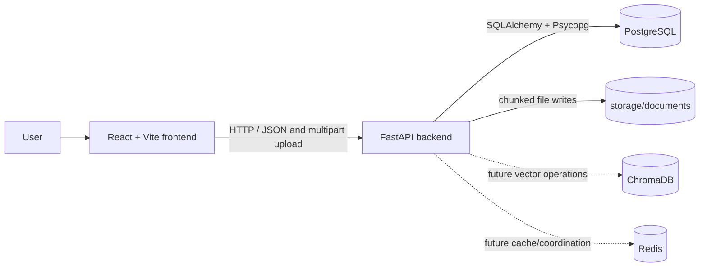
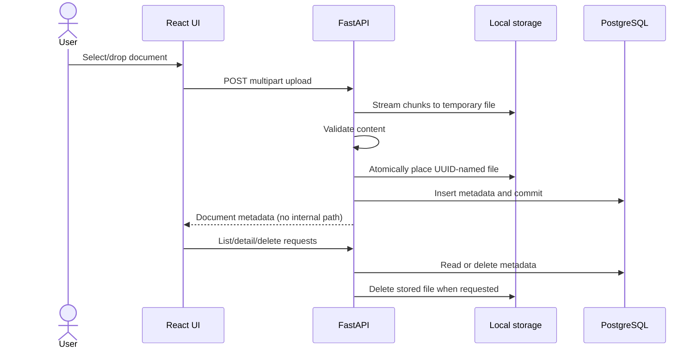

# Architecture

## High-level system

The current application is a React/Vite single-page frontend and a FastAPI backend. The frontend calls the backend over HTTP through the shared Axios client. PostgreSQL stores document metadata; original files are stored locally under the project root at `storage/documents/`.

## Current project layout

```text
backend/app/
  api/document.py             Document Management HTTP routes
  api/processing.py           Multimodal processing HTTP routes
  database/                   SQLAlchemy base and connection/session setup
  models/document.py          PostgreSQL document metadata model
  models/processing.py        Processing state and extracted-content models
  schemas/document.py         API response schemas
  schemas/processing.py       Processing API schemas
  services/document_processing/
                               Format processors, OCR, vision, and pipeline
frontend/src/
  App.jsx                     Document Management interface
  services/apiClient.js       Shared Axios client
  styles/index.css            Application styling
storage/documents/            Local original files (ignored by Git)
tests/test_document_api.py    PostgreSQL-backed API integration tests
docs/                         Project and module documentation
```



## Responsibilities

- **React/Vite frontend:** document upload, list, details, and deletion UI. It communicates with FastAPI using the shared Axios client.
- **FastAPI backend:** validates and stores Module 1 uploads, manages metadata, and starts Module 2 processing in background tasks.
- **PostgreSQL:** stores document metadata, processing job state, and structured extracted content. Original bytes remain in local storage.
- **Local document storage:** stores the original uploaded bytes under `storage/documents/`; the database stores a server-side path, which is not returned to clients.
- **Document processing:** reads existing originals, selects a format-specific parser, optionally performs OCR/visual description, and stores page/slide/sheet-aware content items.
- **ChromaDB:** configured for future vector storage; Module 1 does not access it.
- **Redis:** configured for future caching/coordination; Module 1 does not access it.
- **Docker Compose:** runs PostgreSQL, ChromaDB, and Redis locally with persistent named volumes. The backend and frontend are run separately during development.

## Current Module 1 data flow

1. A user selects or drops one or more supported files in the frontend.
2. The frontend sends each file as a multipart request to FastAPI.
3. The backend validates the filename, extension, non-empty contents, and recognizable file structure/content.
4. The backend writes the upload in bounded chunks to a UUID-named file under `storage/documents/`.
5. After successful file validation/storage, the backend commits metadata to PostgreSQL. On a failed metadata commit it removes the newly stored file.
6. List and detail requests read metadata from PostgreSQL; delete removes both the metadata and the associated stored file while handling rollback.



## Current Module 2 data flow

1. A client starts processing by document ID; the API verifies the existing PostgreSQL document record.
2. The API commits a queued processing record and schedules an in-process FastAPI background task.
3. The pipeline validates the stored path, selects the PDF, DOCX, XLSX, PPTX, or TXT processor, and normalizes extracted content and source metadata.
4. On success, extracted items are atomically replaced in PostgreSQL and the job is marked completed. Failures update the job status and preserve any previously completed content.
5. Status and ordered extracted items are available from the processing status and content endpoints.

## Planned flow across approved modules

1. **Document Management:** receive, validate, store, list, inspect, and delete original documents (implemented).
2. **Multimodal Document Processing:** read supported stored documents, extract text/layout and applicable media, and record processing outcomes (implemented).
3. **Hybrid RAG Engine:** retrieve relevant document content using lexical (BM25) and vector (ChromaDB) search, then rerank candidates.
4. **AI Assistant:** use retrieved context to answer user questions and provide citations.
5. **Semantic Caching:** reuse suitable prior query results through Redis or another approved cache strategy.

Modules 1 and 2 are implemented. Vector writes, retrieval, generation, and caching remain future-module work.
